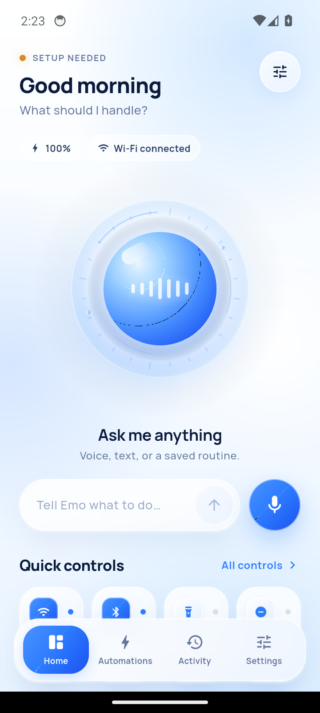
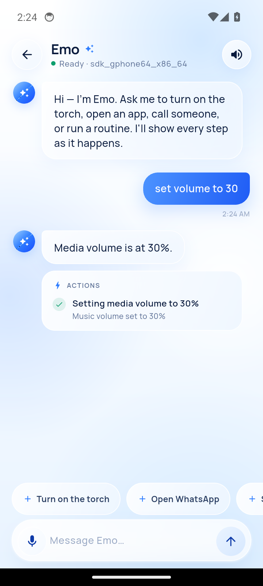
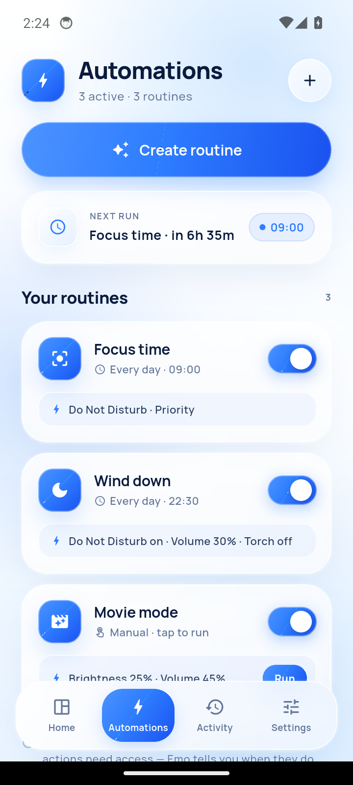
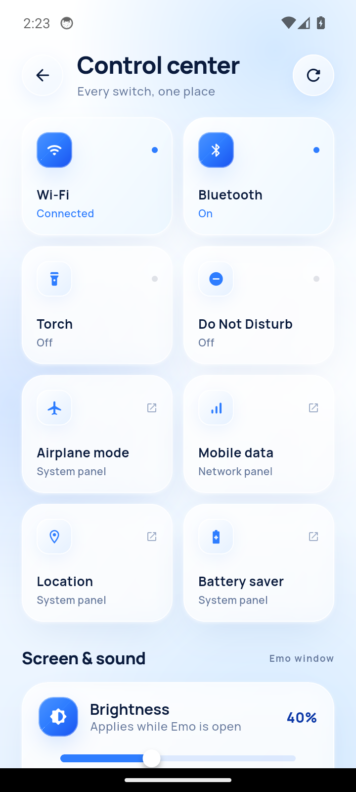
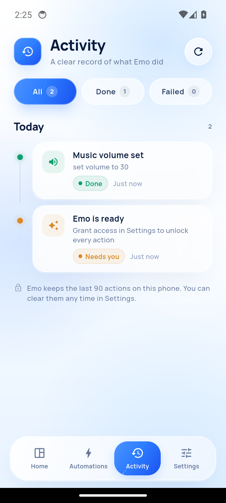
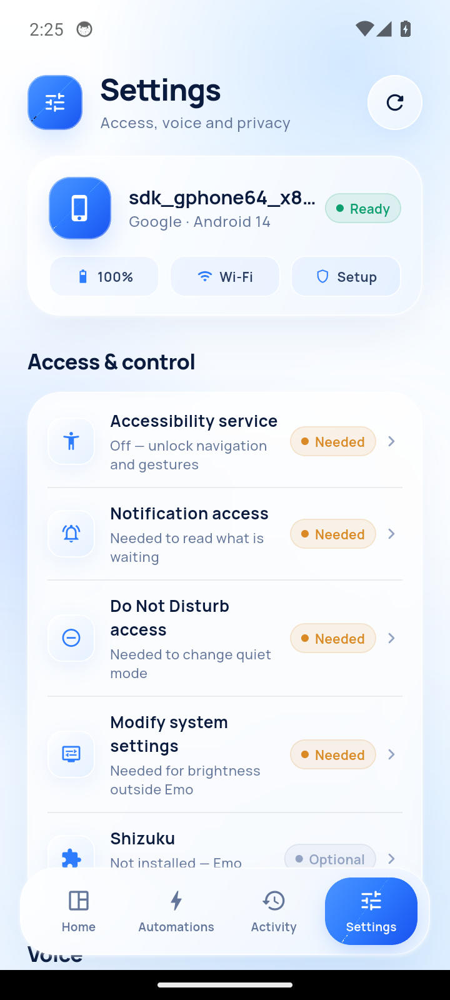
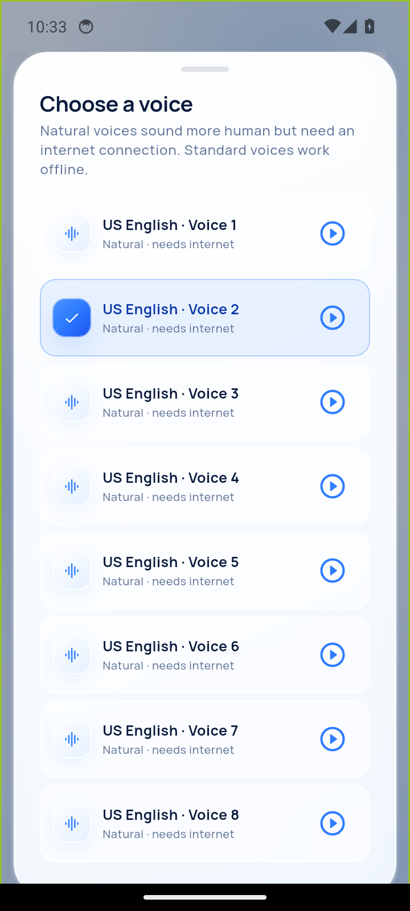

# Emo

**An on-device Android assistant that actually does things.** Talk or type — Emo controls your phone's settings, opens apps, starts calls and messages, and runs saved routines. Commands are parsed and executed on the phone; an optional cloud brain adds free-form understanding with your own provider key. Emo never fabricates a result.

Flutter + Kotlin · min Android 8.0 (API 26) · glassmorphism UI · light theme

## Screens

| Home | Assistant | Automations |
| :---: | :---: | :---: |
|  |  |  |

| Control Center | Activity | Settings |
| :---: | :---: | :---: |
|  |  |  |

| Voice picker |
| :---: |
|  |

## What it can do

- **Voice & text commands** — built-in Android speech recognition (with live partial results) and TTS replies.
- **Pro voice picker** — Emo auto-selects the best natural US English voice your phone's TTS engine exposes, with numbered voices, preview playback and a saved choice. Natural voices stream over the internet; standard voices work offline.
- **Optional cloud brain** — when the offline parser doesn't recognize a request, Emo can ask a cloud model to translate it into one of its real device actions, or answer a general question. Gemini, OpenAI, OpenRouter, Groq and any OpenAI-compatible endpoint are supported with your own API key. The model only returns a structured intent; the phone still performs and reports the action.
- **Optional on-device model** — Qwen 2.5 0.5B (about 521 MB, Apache-2.0) ships **inside the release APK**, and Emo unpacks it into private storage the first time you turn it on. It understands paraphrases and answers short questions with no network, no download and no API key, running through MediaPipe's LLM Inference on the phone's CPU; the cloud is used first when it is set up, and the local model catches failures.
- **Persona and memory** — Emo introduces itself on launch ("Good morning, boss. Emo here — your buddy."), addresses you by the name you choose, and keeps a private on-device memory. Say "remember that I like tea", "my name is Sam", "what do you remember" or "forget everything". Remembered facts are available to the cloud brain when it needs context, and you can review or delete each one in Settings → Emo.
- **System control** — torch, media volume, screen brightness, Do Not Disturb, battery/charging, Wi-Fi and Bluetooth state.
- **Apps & communication** — open any installed app, search contacts and start a call, compose an SMS or WhatsApp message.
- **Routines** — daily schedules via `AlarmManager` (DND, volume, torch, brightness), persisted across restarts and runnable even when the app is closed.
- **Reply and update alerts** — if an answer arrives while Emo is in the background, a notification shows it. Emo also checks GitHub every 6 hours for a newer release and notifies you; tapping the update alert opens the release APK download. Both alert types have switches in Settings, and Settings has a manual "Check" row.
- **Live feedback** — every command renders its execution steps; success, failure and permission needs are shown honestly. An activity timeline records the last 90 actions.
- **Control Center** — glass tile grid for connectivity, display, sound and focus controls, plus sliders for brightness and volume.

## Honest Android limits

Android blocks some actions for third-party apps. Emo opens the right system surface instead of pretending it succeeded:

| Action | Behavior |
| --- | --- |
| Torch, volume, brightness, DND | Directly controlled (brightness/DND need access grants) |
| Wi-Fi / Bluetooth toggles | Opens the system panel on Android 10+ — Android forbids silent toggles |
| Calls & messages | Opens the dialer / composer pre-filled; you confirm the send |
| Lock screen, screenshots | Available only with Accessibility service enabled |
| App launch | Standard intent; no root or Shizuku required |

## Offline first, cloud optional

Known commands never leave the phone. A deterministic on-device parser matches 28 command intents instantly, asks about state instead of toggling it ("is Wi-Fi on?"), and executes through real Android APIs. Memory commands (`remember`, `recall`, `forget`) work with Cloud brain off too.

When **Cloud brain** is enabled and the parser doesn't recognize a message, Emo sends that message, the last few chat turns, your display name, the facts you asked it to remember, and basic device state (battery, brightness, volume, Wi-Fi/Bluetooth/DND, routine names) to the provider you chose. The model must reply with a JSON action from Emo's fixed list; Emo validates it, executes it locally, and reports the real result. Questions that aren't phone actions get a short conversational answer. With Cloud brain off — the default — nothing is uploaded. The API key is kept in the Android keystore and the memory list stays in app storage on the phone.

**On-device model** is the offline alternative. Enable it in Settings → Intelligence and unrecognized requests go to MediaPipe's LLM Inference engine on the phone. The release APK contains the model, so the first enable copies it into the app's private storage — no download. (A build made without the model file present falls back to offering a one-time download instead.) If the cloud is also on, Emo tries the cloud first and falls back to the phone when the cloud has no key, no credits or no connection. Nothing is sent anywhere in local mode.

## Permissions

| Permission | Why |
| --- | --- |
| Microphone | Voice commands (only requested when you tap the mic) |
| Camera | Torch control |
| Contacts | "Call Alex" / "Message Alex" |
| Bluetooth connect | Read adapter state on Android 12+ |
| Notification permission | Reply alerts and update alerts |
| Notification access | Read pending notification count |
| DND access | Toggle Do Not Disturb |
| Modify system settings | Set screen brightness |
| Accessibility | Lock screen and global actions (optional) |

Emo asks at the moment a capability is first used, and Settings shows the current grant state for each one.

## Architecture

```
lib/
  main.dart                 app shell + ambient glass background
  app_state.dart            ChangeNotifier state, persistence, routines/activity
  models.dart               DeviceState, ChatMessage, ActivityEvent, routines
  services/
    command_engine.dart     deterministic intent parser
    cloud_brain.dart        optional OpenAI-compatible NLU + chat client
    local_brain.dart        on-device model download + MediaPipe inference
    intent_contract.dart    shared JSON action contract for every model
    persona.dart            Emo's identity, greetings and system preamble
    memory_store.dart       private on-device facts Emo remembers about you
    update_service.dart     GitHub release check + version comparison
    device_bridge.dart      MethodChannel bridge to Kotlin
    voice_service.dart      speech_to_text + flutter_tts
  screens/                  home, assistant, automations, control center,
                            activity, settings, shell (floating nav)
  widgets/                  glass surfaces, orb, icons, feedback sheets
android/app/src/main/kotlin/.../MainActivity.kt
                            device snapshot, torch, DND, brightness, volume,
                            intents, contacts, alarms, accessibility service
android/app/src/main/kotlin/.../LocalLlm.kt
                            MediaPipe LLM Inference (CPU) + model lifecycle
```

State lives in a single `AppState` (`ChangeNotifier`); persistence uses `shared_preferences`. Routines are scheduled with `AlarmManager` and restored on boot.

## Build

```bash
flutter pub get
flutter build apk --release
```

APK output: `build/app/outputs/flutter-apk/app-release.apk`

Install on a device with developer options enabled:

```bash
adb install -r build/app/outputs/flutter-apk/app-release.apk
```

Requires Flutter 3.35+ and JDK 17. No backend services. The cloud brain is optional and uses your own provider API key, added in **Settings → Intelligence**. The on-device model ships inside the release APK (~650 MB). To make a bundled build from source, copy `Qwen2.5-0.5B-Instruct_multi-prefill-seq_q8_ekv1280.task` from [litert-community/Qwen2.5-0.5B-Instruct](https://huggingface.co/litert-community/Qwen2.5-0.5B-Instruct) into `android/app/src/main/assets/models/` — that folder is gitignored (GitHub rejects files over 100 MB). Without it the build still works and offers the model as an in-app download.

## Install from release

Download the latest `app-release.apk` from [Releases](https://github.com/galaxymushi/emo/releases), allow installation from your file manager, then grant permissions from **Settings → Access** inside the app.

## Verified

Tested on an Android 14 emulator: cold launch without permission prompts, all six screens, command parsing and media-volume execution (`set volume to 30`), routine scheduling and activity logging. Voice selection was verified end to end — the chosen natural voice (`en-us-x-iom-network`) is what Google TTS synthesizes replies with, and it survives an app restart. The cloud path is covered by unit tests for request construction, fenced-JSON parsing, intent mapping, missing-routine clarification and auth errors; the on-device flow without a key was verified to fail honestly. A live provider call needs your own API key. Hardware-dependent surfaces (torch, calls, Wi-Fi panel) use standard Android APIs and intents but were not exercised on the emulator.

---

Built by [galaxymushi](https://github.com/galaxymushi).
